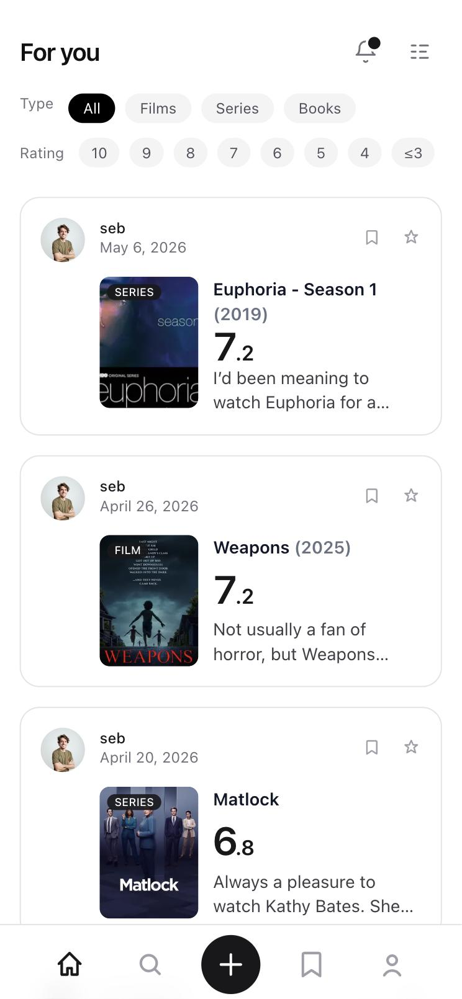
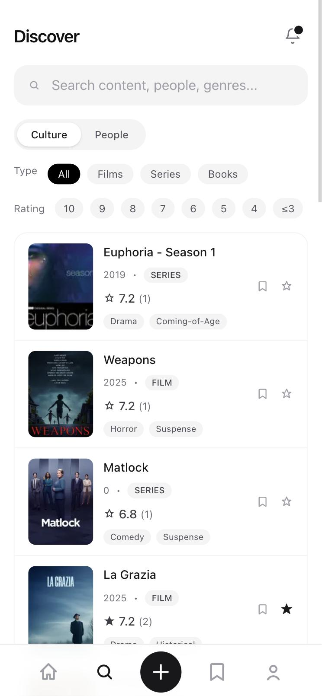
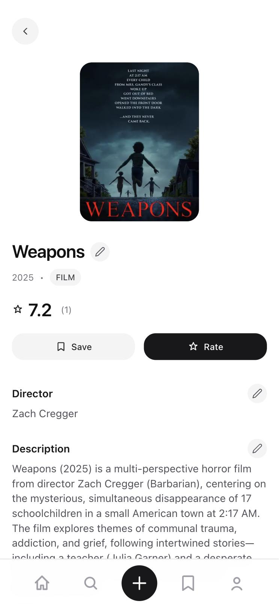
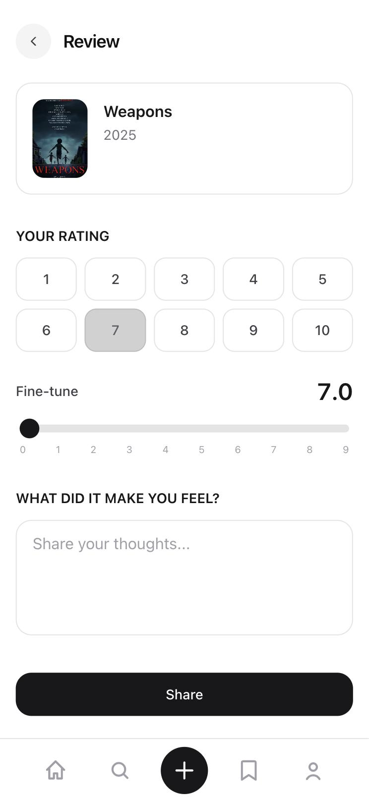

<p align="center">
  
</p>

<h1 align="center">Kanon</h1>

<p align="center">
  <strong>Your cultural club</strong>: one social home for the films, series and books you love.<br>
  <a href="https://www.kanon.club">kanon.club</a> · Live since 2026 · Designed and built by <a href="https://github.com/mayhemjacob">Jacobo Miralles</a>
</p>

<p align="center">
  
  
  
  
</p>

---

## The problem

Most tracking apps cover a single medium: one app for films, another for series, another for books. But people don't experience culture in silos. The recommendations they trust come from friends, not algorithms.

**Kanon treats film, series and books as one thing, culture, and puts friends at the centre.** You rate what you've watched or read, write a few lines about what it made you *feel*, and follow people whose taste you trust.

The name comes from the idea of a *canon*: the works that matter to you, and the people you share them with.

## Key product decisions

| Decision | Why |
|---|---|
| **One catalogue for three media** | Films and series come from TMDB and books from Google Books. All of them are normalised into a single item model, so lists, feeds and taste scores work across media. |
| **Reviews are about feeling, not critique** | The review prompt asks *what did it make you feel*. This lowers the bar to write something and makes reviews more personal and more social. |
| **Ratings from 1.0 to 10.0, in two steps** | Tap a whole number, then fine-tune with a decimal slider. You get precision without friction, and filters match by band (tapping "9" shows 9.0–9.9). |
| **No inline rating on item pages** | It was tried and then reverted. Rating always goes through the review flow, so every score comes with context. |
| **Wiki-style item pages** | Any user can correct a title's director, description and tags, so the catalogue improves as people use it. Reviews remain personal. |
| **Private by default, shareable on purpose** | There is no logged-out browsing. The public web only sees what users choose to share: reviews, lists and taste matches have public links with rich previews for WhatsApp and X. |
| **Social feed, not an algorithmic one** | *For You* shows reviews from people you follow. *Discover* is where you browse the catalogue or find people. |

## What you can do

- **Rate and review** films, series and books on a single scale.
- **For You feed** with reviews from the people you follow.
- **Discover** the catalogue, or switch to find and follow people.
- **Lists and saved items**: curate lists, keep a watch/read-later shelf and save other people's lists.
- **Taste match**: a compatibility score between two users, with a shareable page for each match.
- **Shareable pages** with rich link previews.
- **Notifications** for new follows and reactions to your ratings.

## Learnings

**Built for flaky connections.** Kanon runs serverless against a pooled Postgres database, so running out of connections in the pool is normal rather than exceptional. After a production incident in March 2026, I changed the app to degrade gracefully. It now fails fast, treats a pool timeout as "busy, retry" instead of a 500 error, and runs independent queries concurrently to reduce load. This pattern is now a rule for every new endpoint that hits the database.

**Safe operations on live data.** Production changes follow a simple protocol: back up first, run a `SELECT` that matches the change before any `UPDATE`/`DELETE`, and do nothing destructive while in doubt.

## Known gaps and what's next

- **Duplicate items.** Users can add any title that search doesn't find, which can create duplicates. This is an accepted trade-off for now: coverage matters more than a perfectly clean catalogue at this stage.
- **"Similar content" is a placeholder.** It currently shows the most recently added items. A real recommendation model is the obvious next step, and the taste-match scoring already gives a starting point.
- **Naming consistency.** *Discover* lives under `/search`, a leftover from earlier iterations.

## Built with

Next.js 16 (App Router) · React 19 · TypeScript · Tailwind CSS 4 · Prisma · PostgreSQL (Supabase) · NextAuth (Google sign-in) · TMDB API · Google Books API · Vercel

Built with AI-assisted development: I started in Cursor and later moved to Claude Code. [`CLAUDE.md`](CLAUDE.md) documents the architecture, the product context and the working rules I use with the agent.

---

## Running locally

```bash
npm install
npm run dev      # http://localhost:3000
npm run build    # prisma generate + next build
npm run lint
```

You need a `.env` with `DATABASE_URL`/`DIRECT_URL` (Postgres), NextAuth/Google credentials, and TMDB and Google Books API keys. The schema is in `prisma/schema.prisma`:

```bash
npx prisma generate
npx prisma migrate dev
```

### Database (PostgreSQL)

For fast Home feed loads (<2s), use a **connection pooler** in production:

- **Neon**: use the pooled connection string (host ends with `-pooler`). Add `?pgbouncer=true` if needed.
- **Supabase**: use port `6543` (transaction pooler) instead of `5432`.
- **Railway / other**: consider PgBouncer or Prisma Accelerate.

Add `?connection_limit=1` to your `DATABASE_URL` when using an external pooler, to avoid exhausting connections in serverless. Without a pooler, each serverless request can open a new DB connection, adding 2–5+ seconds on cold starts.

### Share preview regression checklist

Use this checklist when updating public share pages (`/r/*`, `/l/*`, `/match/*`):

1. **Metadata exists in page source**: `og:title`, `og:description`, `og:image` and `twitter:image` are present.
2. **`og:image` is absolute**: it must use `https://<host>/...`, not a relative URL.
3. **OG image route returns `200`**: for example, `/l/<id>/opengraph-image` should return `image/png`.
4. **Fallback is safe**: if data or images fail, the route still returns a valid image (no 500).
5. **Crawler-style fetch passes**: `curl -A "facebookexternalhit/1.1" "<public-url>"` includes the OG tags.
6. **Real external test**: share a production (or tunnel) URL in WhatsApp; if it's cached, retry with a query param.
